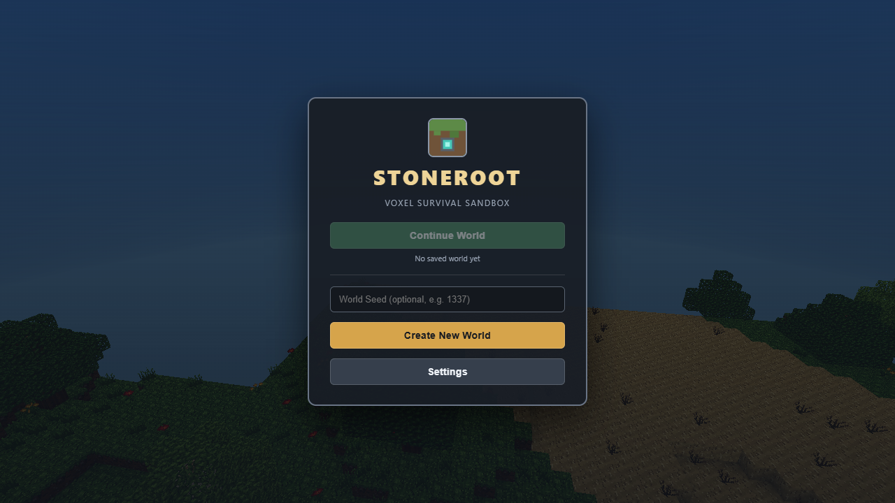
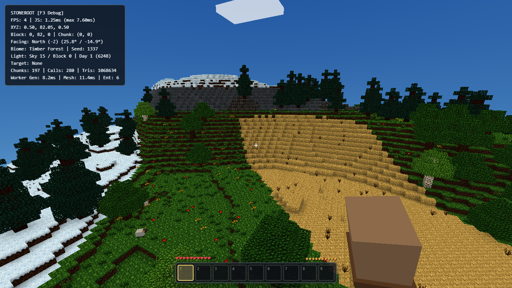
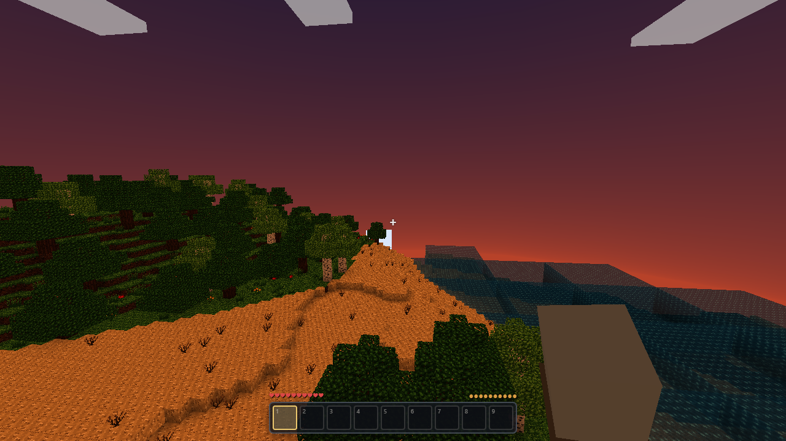
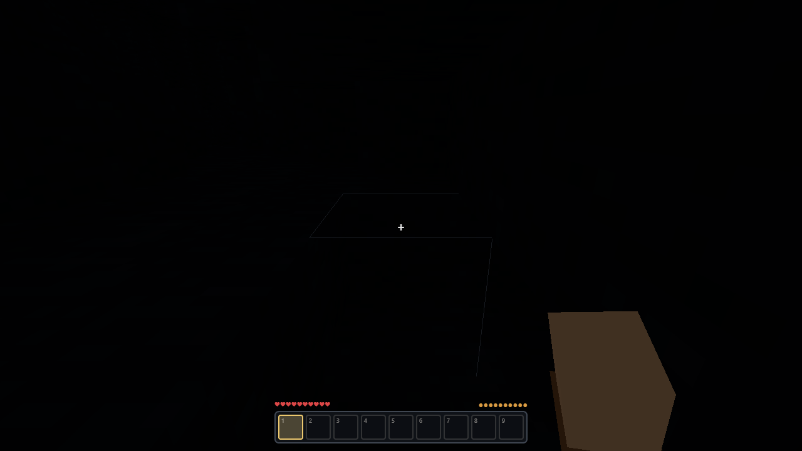
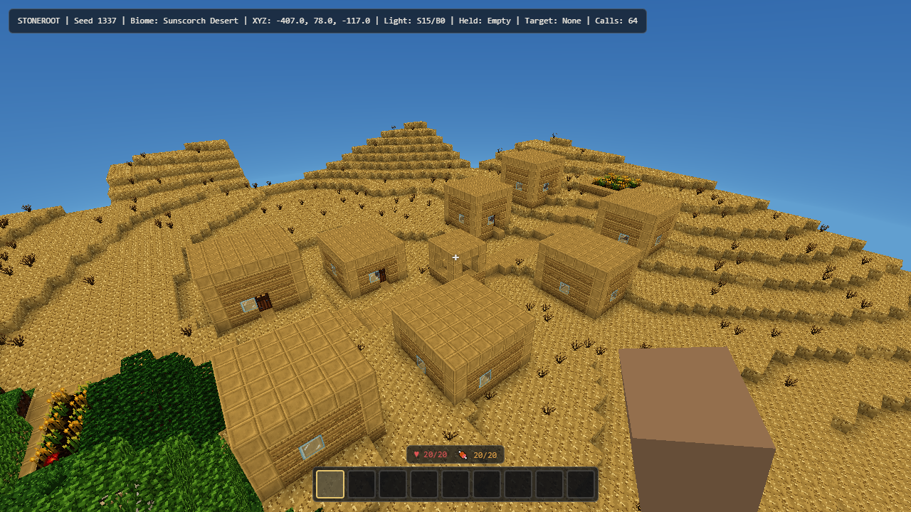
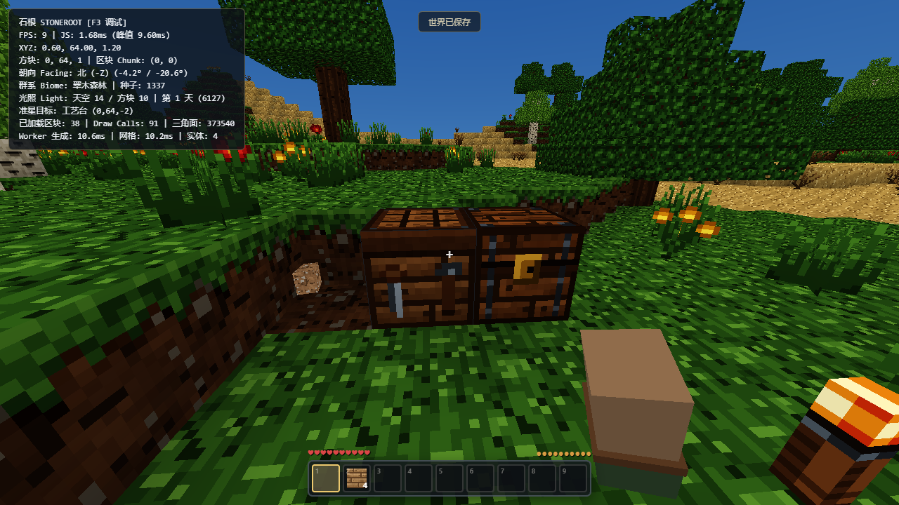

<div align="center">

# STONEROOT

**An original, zero-external-asset first-person voxel survival sandbox for the browser**

[简体中文](./README.md) | **English**


</div>

---

## Overview

**Stoneroot** is built from scratch with **TypeScript, Vite, Three.js, Web Workers, and IndexedDB**. Explore an infinite seed-deterministic voxel world: gather timber, craft tools, mine underground caverns, smelt ore, farm crops, loot biome villages, and survive hostile nights.

- **100% Original & Procedural Assets**: All 56 block textures (16×16 pixel art), 10 mining crack stages, and 78 item icons are procedurally painted on HTML5 Canvas at runtime; all 13 sound effects are synthesized in real time via WebAudio — **zero external art or audio downloads**.
- **Built-in Bilingual UI (ZH / EN)**: Switch instantly between **简体中文** and **English** from the Main Menu, Pause Menu, or Settings modal. Every menu, item, block, biome, death cause, HUD toast, and F3 overlay translates live and persists across reloads.
- **Silky High-Refresh Rendering**: Terrain generation, village placement, initial lighting, and chunk meshing all run off the main thread in a **Web Worker**. Sub-tick camera & entity interpolation delivers smooth 60/120/144Hz motion over a deterministic 20 TPS simulation. Measured at **Render Distance 8 (197 chunks)**: locked **60 FPS** on integrated Intel Iris Xe Graphics with `< 1 ms` main-thread JS time.

---

## Screenshots

| Main Menu (Live 3D Backdrop + Language Toggle) | Render Distance 8 Panorama + F3 Debug Overlay |
|---|---|
|  |  |

| Dusk Sky Gradient & Sunlight Transition | Underground Cave & Warm Pitch Torch Light |
|---|---|
|  |  |

| Deterministic Biome Villages & Farms | Crafting Bench, Supply Chest & Persistence |
|---|---|
|  |  |

---

## Quick Start

### Requirements
- **Node.js** `>= 18` (verified on `v22.23.5`)
- Any modern WebGL-capable browser (Chrome / Edge recommended)

### Run Locally

```bash
# 1. Install dependencies
npm install

# 2. Start Vite dev server
npm run dev
```

Open `http://127.0.0.1:5173/` in your browser.

> **Direct Seed Launch**: Open `http://127.0.0.1:5173/?seed=1337` to jump straight into a world with that seed.

---

## Player Manual & Controls

### Controls

| Input | Action |
|---|---|
| `W` `A` `S` `D` | Move |
| `Space` | Jump / Swim Up / Climb Ladder |
| `Shift` | Sneak (automatic ledge-edge fall guard) |
| `Ctrl` or Double-Tap `W` | Sprint (when hunger permits) |
| `Left Click` | Hold to mine blocks / Click to melee attack mobs |
| `Right Click` | Place block / Open Bench, Kiln, Chest / Toggle door / Eat food / Sleep in bed / Hold to draw bow |
| `1` – `9` or Scroll Wheel | Select hotbar slot |
| `E` | Open / Close Satchel & 2×2 Hand Crafting |
| `Q` | Drop 1 held item |
| `Esc` | Close screen / Pause Menu (Save, Settings, Language) |
| `F3` | Toggle Debug Telemetry Overlay (FPS, XYZ, Chunk, Biome, Light, Draw Calls) |

### Inventory & Container Controls
- **Left Click**: Pick up, place, merge, or swap a stack
- **Right Click**: Split stack in half / place a single item
- **Shift + Left Click**: Quick-transfer between inventory, hotbar, chest, kiln, and crafting output
- **Quick Craft Sidebar**: Displays currently craftable recipes using items already in your inventory for one-click crafting

---

## Survival Guide

### 1. Core Progression Loop
1. **Gather Timber**: Click the canvas to lock pointer, then chop Oak, Silverwood, or Frostpine trees.
2. **Craft a Crafting Bench**: Press `E` to turn logs into planks, sticks, and a **Crafting Bench** (3×3 grid), place it down, and right-click to open.
3. **Stone Age & Smelting**: Craft an **Oak Pickaxe** → mine Stone for Cobblestone → upgrade to Stone tools and craft a **Stone Kiln** (Furnace).
4. **Mining & Iron / Prismite**: Explore 3D caves for **Coal Seams**, **Iron Veins**, **Gold Veins**, and deep **Prismite Crystal Veins**. Smelt Raw Iron Ore with coal or planks in a Stone Kiln to craft Iron tools and armor.
5. **Survive the Night**: Hostile mobs spawn in darkness (`light < 7`). Craft **Pitch Torches** (Coal + Stick) to light up a shelter (a starter Waystone Torch also spawns beside your origin and can be mined/relocated). Craft a **Camp Bed** (Ram Fleece + Planks) to set your spawn point and sleep until dawn.
6. **Farming & Hunting**: Break Wild Grass for **Grain Seeds**, till dirt near water with a Hoe, plant and harvest Golden Grain (or accelerate with Bone Dust) to bake **Hearth Bread**, or hunt passive wildlife and roast meat in a Stone Kiln.

### 2. World, Biomes & Villages
Deterministic seed-driven generation creates **6 natural biomes** (**Meadow Plains**, **Timber Forest**, **Sunscorch Desert**, **Frost Tundra**, **Azure Sea**, **Highland Crags**), 3D caves, gravity-affected Sand/Gravel, finite spreading Water, and sparse **cross-chunk biome villages** (4–8 biome-styled houses, paths, irrigated crop plots, a well, and loot chests generated lazily on first open).

### 3. Original Mobs
- **Passive**: **Meadow Boar** (Raw Boar Cut, Tanned Hide), **Woolhorn Ram** (Raw Ram Cut, Ram Fleece), **Crested Fowl** (Raw Fowl, Crested Feather)
- **Hostile** (spawns strictly at `light < 7`):
  - **Ash Husk**: Melee pursuer; burns in daylight; drops Ash Jerky
  - **Hollow Archer**: Ranged skeleton firing parabolic arrows; burns in daylight; drops Hollow Bone & Fletched Arrows
  - **Gloom Spider**: Wall-climbing cavern arachnid; neutral by day, hostile at night; drops Cavern Silk (used to craft the Recurve Bow)

### 4. Auto-Save & Settings
- Worlds auto-save every **30 seconds** as well as on pause, quit-to-menu, and tab close into browser **IndexedDB** (only modified chunks are persisted, with schema versioning and safe legacy migration).
- Adjust **Language (简体中文 / English)**, **Render Distance (3–12 chunks)**, **FOV (55°–105°)**, **Mouse Sensitivity**, and **Master Volume** live in Settings.

---

## Crafting & Smelting Reference

> Automatically synchronized from [src/registry/recipes.ts](./src/registry/recipes.ts) via [scripts/generate-recipes-doc.ts](./scripts/generate-recipes-doc.ts).

<!-- RECIPES:START -->
### Crafting Recipes

| Output | Station | Pattern / Ingredients |
|---|---|---|
| **Oak Planks ×4** | Hand (2×2) | Shapeless: Oak Timber |
| **Silverwood Planks ×4** | Hand (2×2) | Shapeless: Silverwood Log |
| **Frostpine Planks ×4** | Hand (2×2) | Shapeless: Frostpine Log |
| **Timber Stick ×4** | Hand (2×2) | `P` / `P` (`P`=Any Planks) |
| **Crafting Bench** | Hand (2×2) | `PP` / `PP` (`P`=Any Planks) |
| **Pitch Torch ×4** | Hand (2×2) | `C` / `S` (`C`=Coal Chunk, `S`=Timber Stick) |
| **Bone Dust ×3** | Hand (2×2) | Shapeless: Hollow Bone |
| **Stone Kiln** | Crafting Bench (3×3) | `CCC` / `C·C` / `CCC` (`C`=Cobblestone) |
| **Timber Chest** | Crafting Bench (3×3) | `PPP` / `P·P` / `PPP` (`P`=Any Planks) |
| **Camp Bed** | Crafting Bench (3×3) | `WWW` / `PPP` (`W`=Ram Fleece, `P`=Any Planks) |
| **Timber Door ×3** | Crafting Bench (3×3) | `PP` / `PP` / `PP` (`P`=Any Planks) |
| **Wood Ladder ×3** | Crafting Bench (3×3) | `S·S` / `SSS` / `S·S` (`S`=Timber Stick) |
| **Stone Slab ×6** | Crafting Bench (3×3) | `SSS` (`S`=Stone) |
| **Stone Slab ×6** | Crafting Bench (3×3) | `CCC` (`C`=Cobblestone) |
| **Sandstone ×2** | Hand (2×2) | `SS` / `SS` (`S`=Dune Sand) |
| **Frost Brick ×4** | Hand (2×2) | `SS` / `SS` (`S`=Packed Snow) |
| **Hearth Bread** | Crafting Bench (3×3) | `WWW` (`W`=Golden Grain) |
| **Oak Pickaxe** | Crafting Bench (3×3) | `MMM` / `·S·` / `·S·` (`M`=Any Planks, `S`=Timber Stick) |
| **Oak Hatchet** | Crafting Bench (3×3) | `MM` / `MS` / `·S` (`M`=Any Planks, `S`=Timber Stick) |
| **Oak Spade** | Crafting Bench (3×3) | `M` / `S` / `S` (`M`=Any Planks, `S`=Timber Stick) |
| **Oak Blade** | Crafting Bench (3×3) | `M` / `M` / `S` (`M`=Any Planks, `S`=Timber Stick) |
| **Oak Hoe** | Crafting Bench (3×3) | `MM` / `·S` / `·S` (`M`=Any Planks, `S`=Timber Stick) |
| **Stone Pickaxe** | Crafting Bench (3×3) | `MMM` / `·S·` / `·S·` (`M`=Cobblestone, `S`=Timber Stick) |
| **Stone Hatchet** | Crafting Bench (3×3) | `MM` / `MS` / `·S` (`M`=Cobblestone, `S`=Timber Stick) |
| **Stone Spade** | Crafting Bench (3×3) | `M` / `S` / `S` (`M`=Cobblestone, `S`=Timber Stick) |
| **Stone Blade** | Crafting Bench (3×3) | `M` / `M` / `S` (`M`=Cobblestone, `S`=Timber Stick) |
| **Stone Hoe** | Crafting Bench (3×3) | `MM` / `·S` / `·S` (`M`=Cobblestone, `S`=Timber Stick) |
| **Iron Pickaxe** | Crafting Bench (3×3) | `MMM` / `·S·` / `·S·` (`M`=Iron Ingot, `S`=Timber Stick) |
| **Iron Hatchet** | Crafting Bench (3×3) | `MM` / `MS` / `·S` (`M`=Iron Ingot, `S`=Timber Stick) |
| **Iron Spade** | Crafting Bench (3×3) | `M` / `S` / `S` (`M`=Iron Ingot, `S`=Timber Stick) |
| **Iron Broadsword** | Crafting Bench (3×3) | `M` / `M` / `S` (`M`=Iron Ingot, `S`=Timber Stick) |
| **Iron Hoe** | Crafting Bench (3×3) | `MM` / `·S` / `·S` (`M`=Iron Ingot, `S`=Timber Stick) |
| **Prismite Pickaxe** | Crafting Bench (3×3) | `MMM` / `·S·` / `·S·` (`M`=Prismite Crystal, `S`=Timber Stick) |
| **Prismite Hatchet** | Crafting Bench (3×3) | `MM` / `MS` / `·S` (`M`=Prismite Crystal, `S`=Timber Stick) |
| **Prismite Spade** | Crafting Bench (3×3) | `M` / `S` / `S` (`M`=Prismite Crystal, `S`=Timber Stick) |
| **Prismite Edge** | Crafting Bench (3×3) | `M` / `M` / `S` (`M`=Prismite Crystal, `S`=Timber Stick) |
| **Prismite Hoe** | Crafting Bench (3×3) | `MM` / `·S` / `·S` (`M`=Prismite Crystal, `S`=Timber Stick) |
| **Recurve Bow** | Crafting Bench (3×3) | `·ST` / `S·T` / `·ST` (`S`=Timber Stick, `T`=Cavern Silk) |
| **Fletched Arrow ×4** | Crafting Bench (3×3) | `C` / `S` / `F` (`C`=Cobblestone, `S`=Timber Stick, `F`=Crested Feather) |
| **Fletched Arrow ×4** | Crafting Bench (3×3) | `B` / `S` / `F` (`B`=Hollow Bone, `S`=Timber Stick, `F`=Crested Feather) |
| **Hide Cap** | Crafting Bench (3×3) | `MMM` / `M·M` (`M`=Tanned Hide) |
| **Hide Tunic** | Crafting Bench (3×3) | `M·M` / `MMM` / `MMM` (`M`=Tanned Hide) |
| **Hide Trousers** | Crafting Bench (3×3) | `MMM` / `M·M` / `M·M` (`M`=Tanned Hide) |
| **Hide Boots** | Crafting Bench (3×3) | `M·M` / `M·M` (`M`=Tanned Hide) |
| **Iron Helm** | Crafting Bench (3×3) | `MMM` / `M·M` (`M`=Iron Ingot) |
| **Iron Cuirass** | Crafting Bench (3×3) | `M·M` / `MMM` / `MMM` (`M`=Iron Ingot) |
| **Iron Greaves** | Crafting Bench (3×3) | `MMM` / `M·M` / `M·M` (`M`=Iron Ingot) |
| **Iron Sabatons** | Crafting Bench (3×3) | `M·M` / `M·M` (`M`=Iron Ingot) |

### Smelting & Cooking (Stone Kiln)

| Input | Output |
|---|---|
| Raw Iron Ore | **Iron Ingot** ×1 |
| Raw Gold Ore | **Gold Ingot** ×1 |
| Dune Sand | **Clear Glass** ×1 |
| Cobblestone | **Stone** ×1 |
| Raw Boar Cut | **Roasted Boar** ×1 |
| Raw Ram Cut | **Seared Mutton** ×1 |
| Raw Fowl | **Roast Fowl** ×1 |
| Oak Timber | **Coal Chunk** ×1 |
| Silverwood Log | **Coal Chunk** ×1 |
| Frostpine Log | **Coal Chunk** ×1 |
<!-- RECIPES:END -->

---

## Architecture & Measured Performance

| Subsystem | Implementation Highlights |
|---|---|
| World & Meshing | `16×128×16` chunks generated & face-culled in a Web Worker with 4-corner smooth lighting, vertex AO, and separate opaque / cutout / translucent geometry buckets |
| Physics & Raycast | Substepped swept AABB collision (anti-tunneling falls, wall slide, 0.5-block slab step-up, sneak edge guard, swimming, ladders) + Amanatides-Woo 3D DDA voxel raycast |
| Lighting & Sky | Incremental cross-chunk BFS sky & block light propagation; O(1) GPU uniform day/dusk/midnight sky dome, starfield, drifting clouds, and horizon-matched fog |
| Smoothness & Perf | Sub-tick render interpolation (20 TPS physics → 60/120/144Hz camera & entity motion), time-sliced Worker drain, 52-bit integer chunk map keys, single-draw-call `InstancedMesh` particles |

### Measured Benchmarks (Render Distance 8 · 197 Chunks · 1280×720)
- **Real Hardware GPU** (`Intel(R) Iris(R) Xe Graphics`, D3D11 ANGLE): **Locked 60 FPS** (`0.18–0.65 ms` avg main-thread JS)
- **Headless SwiftShader Main-Thread JS** (excl. GPU): Steady avg **`0.77 ms`** (max `1.1 ms`), crossing 14 chunk borders avg **`2.02 ms`** (max single frame `5.8 ms`)
- **Web Worker Per-Chunk Timing**: Gen avg `8.2–11.9 ms`, Mesh avg `11.3–13.5 ms`

See [ARCHITECTURE.md](./ARCHITECTURE.md) and [docs/FINAL_REPORT.md](./docs/FINAL_REPORT.md) for full technical documentation and milestone verification logs.

---

## Build & Test Commands

| Command | Description |
|---|---|
| `npm run dev` | Start Vite development server (`http://127.0.0.1:5173`) |
| `npm run build` | Type-check (`tsc --noEmit`) and build production bundle |
| `npm run preview` | Preview production bundle locally |
| `npm test` | Run Vitest unit test suite (9 files, 35 tests) |
| `npm run e2e` | Run full Playwright E2E regression & benchmark suite (9 specs, M0–M8) |
| `npm run docs:recipes` | Regenerate crafting & smelting tables in both `README.md` and `README.en.md` |
