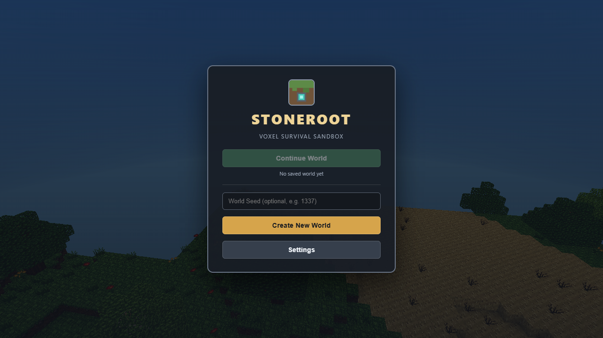
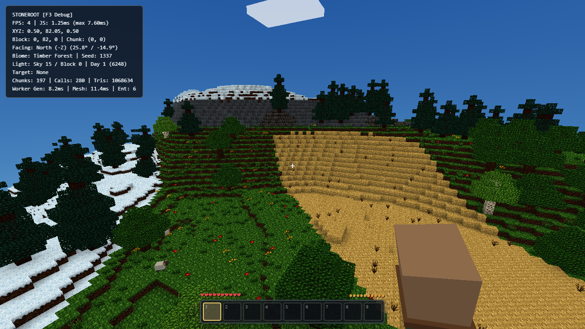
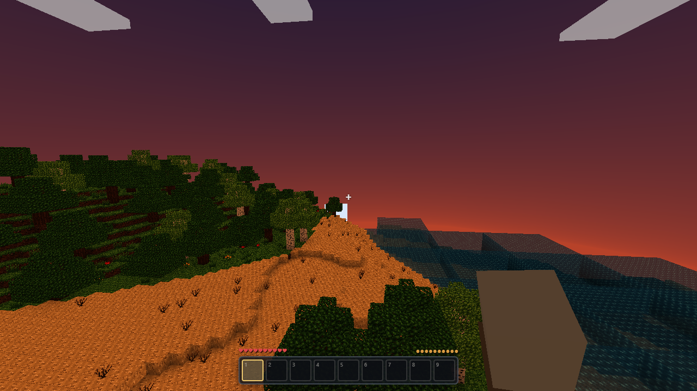
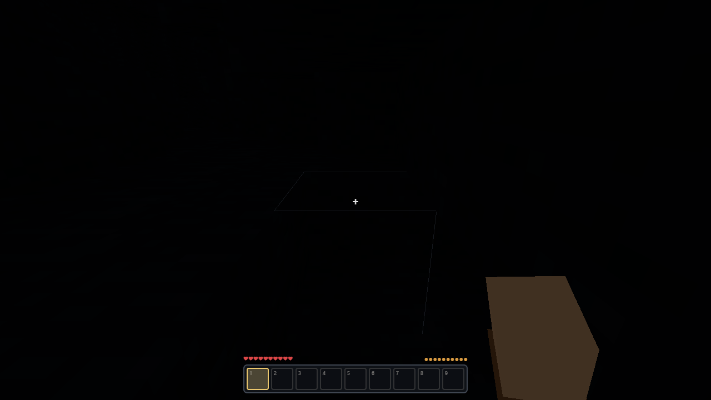
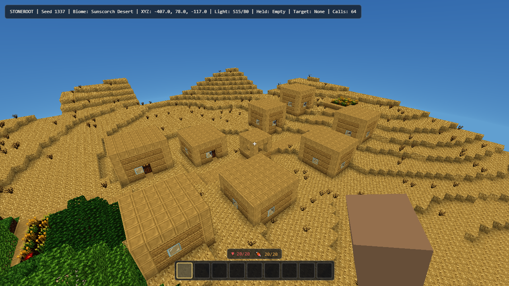
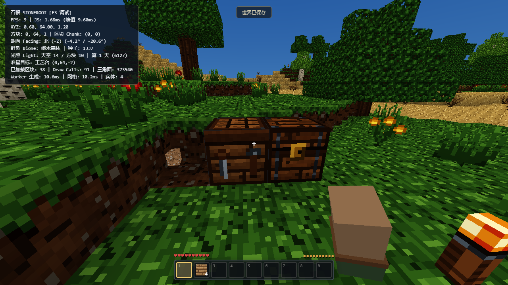

<div align="center">

# 石根 STONEROOT

**一款完全原创、零外部素材的浏览器端第一人称体素生存沙盒游戏**

**简体中文** | [English](./README.en.md) | 📖 [完整玩家使用手册](./USER_MANUAL.md)


</div>

---

## 游戏简介

**石根（Stoneroot）** 基于 **TypeScript + Vite + Three.js + Web Worker + IndexedDB** 从零构建。你在按种子确定性生成的无限方块世界里采集、合成、建造、耕种与战斗，度过危机四伏的黑夜。

- **100% 原创与程序化资源**：全部 56 种 16×16 像素方块贴图、10 阶段挖掘裂纹、78 种物品图标均在运行时通过 Canvas 程序化生成；13 种游戏音效通过 WebAudio 实时合成，**零外部美术/音频依赖**。
- **中英文双语界面**：主菜单、暂停菜单及设置界面支持一键切换 **简体中文 / English**，涵盖全部菜单、物品、方块、群系、死亡提示与 `F3` 调试面板，设置自动持久化。
- **高刷流畅渲染**：地形生成、村庄布置、光照初始化与网格构建均在 **Web Worker** 完成；主线程采用子帧插值相机（平滑适配 60 / 120 / 144Hz 屏幕）与时间片分帧上传。实测在 **视距 8（197 区块）** 下，集成显卡（Intel Iris Xe）稳锁 **60 FPS**，主线程每帧 JS 耗时 `< 1 ms`。

---

## 实机截图

| 主菜单（实时 3D 背景 + 双语切换） | 视距 8 多群系全景 + F3 调试面板 |
|---|---|
|  |  |

| 黄昏日落渐变与天光 | 地下洞穴与松脂火把暖光 |
|---|---|
|  |  |

| 群系自然村庄与农田 | 工艺台、储物箱与存档恢复 |
|---|---|
|  |  |

---

## 快速开始

### 环境要求
- **Node.js** `>= 18`（本项目实测版本：`v22.23.5`）
- 支持 WebGL 的现代浏览器（推荐 Chrome / Edge）

### 本地运行

```bash
# 1. 安装依赖
npm install

# 2. 启动开发服务器
npm run dev
```

启动后在浏览器打开：`http://127.0.0.1:5173/`

> **快捷进入指定种子**：直接访问 `http://127.0.0.1:5173/?seed=1337` 可跳过主菜单直接进入对应种子的世界。

---

## 操作说明书

### 基础键位

| 按键 / 操作 | 功能说明 |
|---|---|
| `W` `A` `S` `D` | 前后左右移动 |
| `Space` | 跳跃 / 在水中上浮 / 向上攀爬木梯 |
| `Shift` | 潜行（走到方块边缘自动防坠落） |
| `Ctrl` 或双击 `W` | 奔跑（饱食度足够时生效） |
| `鼠标左键` | 长按挖掘方块 / 点击近战攻击生物 |
| `鼠标右键` | 放置方块 / 打开工艺台、熔炉、箱子 / 开关木门 / 进食 / 睡营地床 / 长按蓄力射弓 |
| `1` – `9` 或滚轮 | 切换底部 9 格快捷栏 |
| `E` | 打开 / 关闭背包与 2×2 徒手合成界面 |
| `Q` | 丢弃当前手持物品（每次 1 个） |
| `Esc` | 关闭当前界面 / 打开暂停菜单（保存、设置、切换语言） |
| `F3` | 开启 / 关闭左上角调试信息面板（FPS、坐标、区块、群系、光照、绘制统计） |

### 背包与容器操作
- **左键单击**：拾取整组物品 / 放置 / 合并或交换槽位
- **右键单击**：拆分一半物品 / 逐个放置单个物品
- **Shift + 左键**：在背包、快捷栏、箱子、熔炉与合成产出槽之间快速转移
- **快捷合成栏**：背包与工艺台右侧会自动列出当前材料可直接合成的配方，点击即可一键合成

---

## 生存玩法指南

### 1. 开局流程（从徒手到铁器与棱晶）
1. **撸树起步**：左键点击画面锁定视角，先砍伐身旁的橡木、银桦或霜松原木。
2. **制作工艺台**：按 `E` 打开随身背包，将原木合成为木板 → 木棍 → **工艺台（Crafting Bench）**，放到地上右键打开 3×3 合成网格。
3. **工具升级**：合成 **橡木镐** 挖石头获取圆石 → 升级 **石镐** 并制作 **石窑熔炉（Stone Kiln）**。
4. **挖矿炼铁**：深入地下洞穴采集 **煤矿脉**、**铁矿脉**、**金矿脉**，深层矿洞可发现稀有宝石 **棱晶宝石矿脉（Prismite）**。在熔炉中放入煤炭或木板作燃料，冶炼粗铁获得 **铁锭**，打造全套铁工具与铁盔甲。
5. **度过黑夜**：在低光照区域（光照 `< 7`）夜晚会刷新敌对生物。用煤块 + 木棍合成 **松脂火把（Pitch Torch）** 照明庇护所（出生点旁也有一支路标火把可直接挖取复用）；用绵羊毛毡 + 木板制作 **营地床（Camp Bed）**，右键可绑定重生点并一觉跳到黎明。
6. **种田与狩猎**：打掉野草概率掉落 **谷物种子**；用锄头右键水边泥土开垦湿润耕地并播种，等待成熟（或用骨粉催熟）收获黄金谷穗烘焙 **炉烤面包**；也可狩猎动物在熔炉烤肉恢复生命与饱食度。

### 2. 世界与群系
按种子确定性生成 **6 大自然群系**：**草甸平原**、**翠木森林**、**烈日沙漠**、**冰霜苔原**、**碧蓝海洋**、**高地峰峦**；内置 3D 洞穴、重力砂/砂砾、有限扩散水流，以及在平原/沙漠/雪原稀疏生成的**跨区块自然村庄**（4–8 栋随群系变色的房屋、土路、农田、水井与首次打开时随机生成战利品的储物箱）。

### 3. 原创生物生态
- **被动生物**：**草甸野猪**（掉生野猪肉、鞣制皮革）、**卷角绵羊**（掉生羊肉、绵羊毛毡）、**羽冠鸡**（掉生禽肉、羽冠羽毛）
- **敌对生物**（仅在光照 `< 7` 处生成）：
  - **灰烬行尸（Ash Husk）**：近战追击，白天在阳光下燃烧，掉落灰烬肉干
  - **骸骨弓手（Hollow Archer）**：保持距离发射抛物线羽箭，白天在阳光下燃烧，掉落空心兽骨与羽箭
  - **幽影巨蛛（Gloom Spider）**：可攀爬墙壁，白天中立、夜晚敌对，掉落洞穴蛛丝（可合成反曲弓）

### 4. 自动存档与设置
- 游戏每 **30 秒自动保存**，暂停、返回主菜单或关闭标签页时也会触发保存，数据存储在浏览器 **IndexedDB**（仅持久化被修改过的区块，体积轻量且支持存档版本号迁移与损坏保护）。
- 可在 **设置** 中实时调节：**界面语言（简体中文 / English）**、**视距（3–12 区块）**、**视野 FOV（55°–105°）**、**鼠标灵敏度** 与 **主音量**。

---

## 合成与冶炼配方表

> 以下配方表由 [scripts/generate-recipes-doc.ts](./scripts/generate-recipes-doc.ts) 从 [src/registry/recipes.ts](./src/registry/recipes.ts) 自动同步生成。

<!-- RECIPES:START -->
### 合成配方

| 产出物品 | 合成站 | 摆放方式 / 所需材料 |
|---|---|---|
| **橡木木板 ×4** | 徒手 (2×2) | 无序：橡木原木 |
| **银桦木板 ×4** | 徒手 (2×2) | 无序：银桦原木 |
| **霜松木板 ×4** | 徒手 (2×2) | 无序：霜松原木 |
| **木棍 ×4** | 徒手 (2×2) | `P` / `P` (`P`=任意木板) |
| **工艺台** | 徒手 (2×2) | `PP` / `PP` (`P`=任意木板) |
| **松脂火把 ×4** | 徒手 (2×2) | `C` / `S` (`C`=煤块，`S`=木棍) |
| **骨粉 ×3** | 徒手 (2×2) | 无序：空心兽骨 |
| **石窑熔炉** | 工艺台 (3×3) | `CCC` / `C·C` / `CCC` (`C`=圆石) |
| **木质储物箱** | 工艺台 (3×3) | `PPP` / `P·P` / `PPP` (`P`=任意木板) |
| **营地床** | 工艺台 (3×3) | `WWW` / `PPP` (`W`=绵羊毛毡，`P`=任意木板) |
| **木门 ×3** | 工艺台 (3×3) | `PP` / `PP` / `PP` (`P`=任意木板) |
| **木梯 ×3** | 工艺台 (3×3) | `S·S` / `SSS` / `S·S` (`S`=木棍) |
| **石台阶 ×6** | 工艺台 (3×3) | `SSS` (`S`=石头) |
| **石台阶 ×6** | 工艺台 (3×3) | `CCC` (`C`=圆石) |
| **砂岩 ×2** | 徒手 (2×2) | `SS` / `SS` (`S`=沙丘细沙) |
| **霜雪砖 ×4** | 徒手 (2×2) | `SS` / `SS` (`S`=积雪块) |
| **炉烤面包** | 工艺台 (3×3) | `WWW` (`W`=黄金谷穗) |
| **橡木镐** | 工艺台 (3×3) | `MMM` / `·S·` / `·S·` (`M`=任意木板，`S`=木棍) |
| **橡木斧** | 工艺台 (3×3) | `MM` / `MS` / `·S` (`M`=任意木板，`S`=木棍) |
| **橡木锹** | 工艺台 (3×3) | `M` / `S` / `S` (`M`=任意木板，`S`=木棍) |
| **橡木剑** | 工艺台 (3×3) | `M` / `M` / `S` (`M`=任意木板，`S`=木棍) |
| **橡木锄** | 工艺台 (3×3) | `MM` / `·S` / `·S` (`M`=任意木板，`S`=木棍) |
| **石镐** | 工艺台 (3×3) | `MMM` / `·S·` / `·S·` (`M`=圆石，`S`=木棍) |
| **石斧** | 工艺台 (3×3) | `MM` / `MS` / `·S` (`M`=圆石，`S`=木棍) |
| **石锹** | 工艺台 (3×3) | `M` / `S` / `S` (`M`=圆石，`S`=木棍) |
| **石剑** | 工艺台 (3×3) | `M` / `M` / `S` (`M`=圆石，`S`=木棍) |
| **石锄** | 工艺台 (3×3) | `MM` / `·S` / `·S` (`M`=圆石，`S`=木棍) |
| **铁镐** | 工艺台 (3×3) | `MMM` / `·S·` / `·S·` (`M`=铁锭，`S`=木棍) |
| **铁斧** | 工艺台 (3×3) | `MM` / `MS` / `·S` (`M`=铁锭，`S`=木棍) |
| **铁锹** | 工艺台 (3×3) | `M` / `S` / `S` (`M`=铁锭，`S`=木棍) |
| **铁阔剑** | 工艺台 (3×3) | `M` / `M` / `S` (`M`=铁锭，`S`=木棍) |
| **铁锄** | 工艺台 (3×3) | `MM` / `·S` / `·S` (`M`=铁锭，`S`=木棍) |
| **棱晶镐** | 工艺台 (3×3) | `MMM` / `·S·` / `·S·` (`M`=棱晶宝石，`S`=木棍) |
| **棱晶斧** | 工艺台 (3×3) | `MM` / `MS` / `·S` (`M`=棱晶宝石，`S`=木棍) |
| **棱晶锹** | 工艺台 (3×3) | `M` / `S` / `S` (`M`=棱晶宝石，`S`=木棍) |
| **棱晶利刃** | 工艺台 (3×3) | `M` / `M` / `S` (`M`=棱晶宝石，`S`=木棍) |
| **棱晶锄** | 工艺台 (3×3) | `MM` / `·S` / `·S` (`M`=棱晶宝石，`S`=木棍) |
| **反曲弓** | 工艺台 (3×3) | `·ST` / `S·T` / `·ST` (`S`=木棍，`T`=洞穴蛛丝) |
| **羽箭 ×4** | 工艺台 (3×3) | `C` / `S` / `F` (`C`=圆石，`S`=木棍，`F`=羽冠羽毛) |
| **羽箭 ×4** | 工艺台 (3×3) | `B` / `S` / `F` (`B`=空心兽骨，`S`=木棍，`F`=羽冠羽毛) |
| **皮帽** | 工艺台 (3×3) | `MMM` / `M·M` (`M`=鞣制皮革) |
| **皮甲上衣** | 工艺台 (3×3) | `M·M` / `MMM` / `MMM` (`M`=鞣制皮革) |
| **皮护腿** | 工艺台 (3×3) | `MMM` / `M·M` / `M·M` (`M`=鞣制皮革) |
| **皮靴** | 工艺台 (3×3) | `M·M` / `M·M` (`M`=鞣制皮革) |
| **铁盔** | 工艺台 (3×3) | `MMM` / `M·M` (`M`=铁锭) |
| **铁胸甲** | 工艺台 (3×3) | `M·M` / `MMM` / `MMM` (`M`=铁锭) |
| **铁护腿** | 工艺台 (3×3) | `MMM` / `M·M` / `M·M` (`M`=铁锭) |
| **铁战靴** | 工艺台 (3×3) | `M·M` / `M·M` (`M`=铁锭) |

### 熔炉冶炼与烹饪（石窑熔炉）

| 原料 | 产出 |
|---|---|
| 粗铁矿 | **铁锭** ×1 |
| 粗金矿 | **金锭** ×1 |
| 沙丘细沙 | **透明玻璃** ×1 |
| 圆石 | **石头** ×1 |
| 生野猪肉 | **炙烤野猪肉** ×1 |
| 生羊肉 | **香煎羊肉** ×1 |
| 生禽肉 | **烤冠鸡** ×1 |
| 橡木原木 | **煤块** ×1 |
| 银桦原木 | **煤块** ×1 |
| 霜松原木 | **煤块** ×1 |
<!-- RECIPES:END -->

---

## 核心技术架构与实测性能

| 模块 | 实现要点 |
|---|---|
| 地形与网格 | 16×128×16 区块，Web Worker 异步生成与面剔除网格构建（支持 4 角平滑光照 + 顶点 AO + 三层不透明/镂空/半透明分桶） |
| 物理与交互 | 子步进 AABB 碰撞（高速防穿墙、贴墙滑动、半砖台阶自动迈步、潜行防坠落、游泳、爬梯）+ Amanatides-Woo 3D DDA 射线拾取 |
| 光照与天空 | BFS 天空光与方块光跨区块增量传播，GPU Uniform 实时驱动日出/正午/黄昏/午夜天光、星空、云层与同色雾 |
| 流畅度优化 | 子帧渲染插值（20 TPS 物理 → 60/120/144Hz 顺滑移动）、时间片分帧 Worker 集成、52 位整数区块索引、合批单 DrawCall 粒子系统 |

### 实测性能数据（视距 8 · 197 区块 · 1280×720）
- **真实 GPU 帧率**（Intel Iris Xe Direct3D11）：**稳锁 60 FPS**（主线程 JS 均值 `0.18–0.65 ms`）
- **无头 SwiftShader 主线程 JS 耗时**（不含 GPU）：稳态均值 **`0.77 ms`**（峰值 `1.1 ms`），连续穿越 14 个区块边界均值 **`2.02 ms`**（最长单帧 `5.8 ms`）
- **Web Worker 单区块耗时**：生成均值 `8.2–11.9 ms`，网格构建均值 `11.3–13.5 ms`

更多架构细节与完整验收报告见 [ARCHITECTURE.md](./ARCHITECTURE.md) 与 [docs/FINAL_REPORT.md](./docs/FINAL_REPORT.md)。

---

## 开发与测试命令

| 命令 | 说明 |
|---|---|
| `npm run dev` | 启动 Vite 本地开发服务器（默认 `http://127.0.0.1:5173`） |
| `npm run build` | TypeScript 严格类型检查（`tsc --noEmit`）+ 生产构建 |
| `npm run preview` | 预览生产构建产物 |
| `npm test` | 运行 Vitest 单元测试（9 组共 35 个用例） |
| `npm run e2e` | 运行 Playwright 端到端冒烟与玩法/性能回归测试（9 个完整场景） |
| `npm run docs:recipes` | 从 `src/registry/recipes.ts` 自动重新生成 `README.md` 与 `README.en.md` 配方表 |
