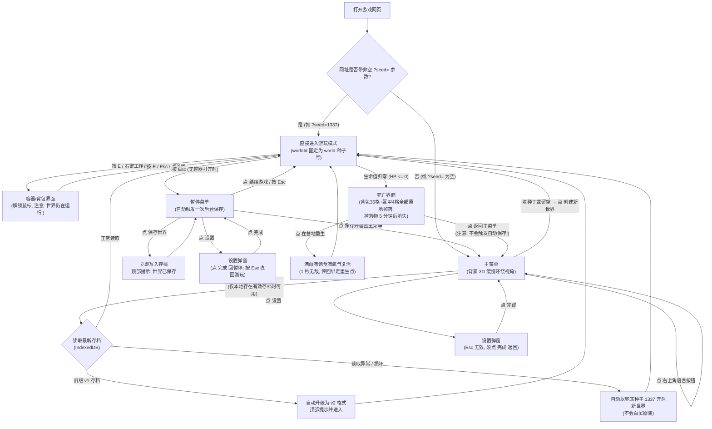
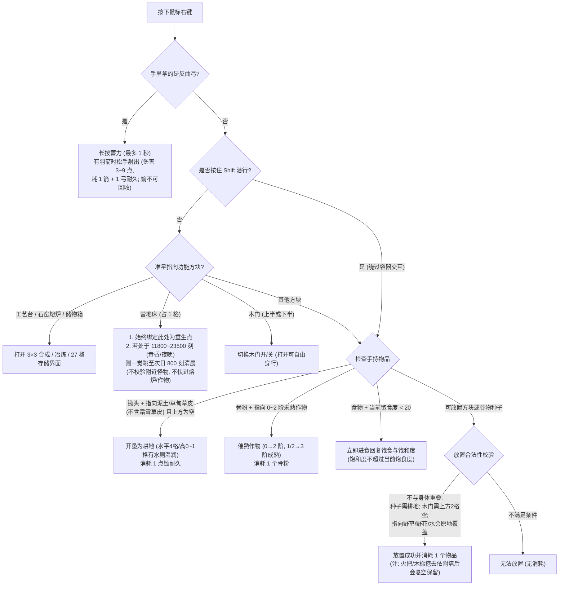
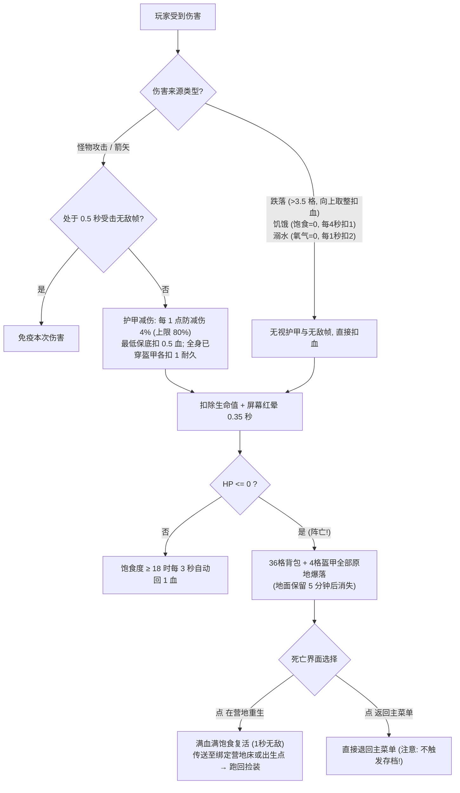
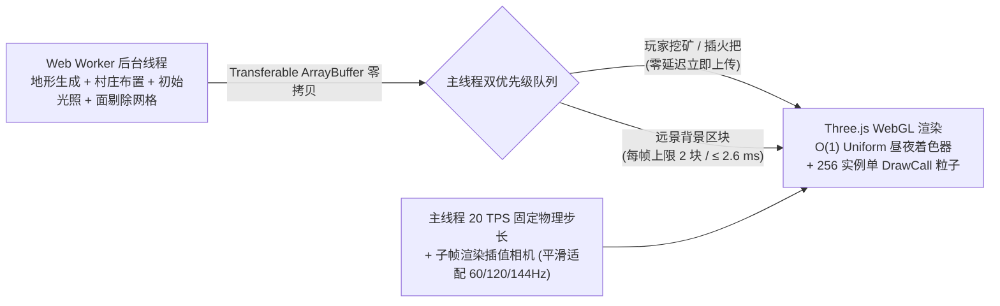

# 《石根 STONEROOT》玩家使用手册

> **对应仓库**：[`GYC-Debug-create/minecraft-gemini-4-neon`](https://github.com/GYC-Debug-create/minecraft-gemini-4-neon)  
> **适用对象**：所有想在浏览器中畅玩《石根 STONEROOT》的玩家（含纯新手与进阶生存玩家），以及关注游戏工程落地的评审者  
> **文档定位**：本手册依据 **ISO/IEC/IEEE 26514** 与 **GB/T 8567-2006（软件用户手册）** 规范编写，经**双轮独立源码交叉审查**核实，全面覆盖“打开后怎么玩、每个界面按钮与按键后果、全部规则与边界、避坑排查及工程落地亮点”。环境安装与开发构建命令请参阅仓库根目录的 `README.md`。

---

## 目录

1. [游戏简介、核心特色与版本边界](#一游戏简介核心特色与版本边界)
2. [全局状态与界面流转总图](#二全局状态与界面流转总图)
3. [全界面与按钮操作后果表](#三全界面与按钮操作后果表)
4. [操作键位与背包容器交互大全](#四操作键位与背包容器交互大全)
5. [新手生存路线、受伤死亡闭环与核心数值](#五新手生存路线受伤死亡闭环与核心数值)
6. [生物生态、耕种、群系与自然村庄](#六生物生态耕种群系与自然村庄)
7. [全部 48 条合成、10 条冶炼与燃料速查表](#七全部-48-条合成10-条冶炼与燃料速查表)
8. [存档机制、性能调优与实战排障 FAQ](#八存档机制性能调优与实战排障-faq)
9. [工程落地与用户体验设计亮点](#九工程落地与用户体验设计亮点)

---

## 一、游戏简介、核心特色与版本边界

**《石根 STONEROOT》** 是一款完全运行在浏览器中的第一人称 3D 体素生存沙盒游戏（类 Minecraft）。你将在按“世界种子”确定性生成的无限方块世界里砍树、挖矿、合成、盖房、耕种、探索自然村庄与地下洞穴，并在危机四伏的黑夜里存活下去。

- **零外部素材，程序化生成**：全部 **48 种实体方块**共享的 **56 张 16×16 贴图块**、10 阶段挖掘裂纹、**79 种物品（78 张 32×32 像素图标）**和 **13 种音效**均在运行时由浏览器实时合成，零外部美术/音频依赖。
- **中英文双语无缝切换**：主菜单、暂停菜单、设置面板支持一键切换 **简体中文 / English**，涵盖全部物品、方块、群系、死亡提示与 `F3` 调试面板。
- **完整生存闭环**：6 大自然群系、跨区块自然村庄（带战利品宝箱）、3D 洞穴、昼夜光照、6 种原创被动/敌对生物、**48 条合成配方**、**10 条熔炉冶炼配方**与 IndexedDB 增量自动存档。
- **当前版本明确边界（防新手误找）**：本版本聚焦纯粹的第一人称单人生存核心闭环，**不包含**水桶（不可搬运水源）、树苗（树木砍完不可补种）、红石电路、附魔、药水、村民交易、盾牌、下界/末地、作弊指令或多人联机。

---

## 二、全局状态与界面流转总图

下图展示了从打开网页开始，在**主菜单、游玩、暂停、设置、容器界面、死亡重生**之间全部可能的跳转分支与存档触发时机：

> ⚠️ **生存安全警告（切屏不暂停）**：按 `Alt+Tab` 切换窗口或切浏览器标签时，游戏会自动松开按键并解锁鼠标，但**世界不会自动暂停**！离开电脑或切屏前请**务必先按 `Esc` 打开暂停菜单**，否则可能原地被怪物击杀。

---

## 三、全界面与按钮操作后果表

### 3.1 主菜单界面

> **提示**：主菜单当前追踪并展示**最近保存的 1 个有效世界**，不提供多世界列表、自定义世界名称输入框或删除存档按钮。若旧存档损坏或版本不兼容，主菜单会自动置灰「继续世界」；新建世界并保存后即成为新的继续目标。

| 界面元素 / 按钮 | 何时可操作 / 状态说明 | 点击或操作后的具体后果 |
| :--- | :--- | :--- |
| **右上角语言切换** (`🌐 English` / `🌐 中文`) | 随时可点 | 立即在简体中文与英文间切换全部界面、物品、群系与调试文本，并自动持久化保存。 |
| **继续世界** | 仅有有效本地存档时可点；无存档或存档损坏时置灰 | 显示摘要（`已存种子 · 第 N 天`）。点击恢复种子、时间、坐标、状态、重生点、背包/盔甲、容器物品与改动区块；旧版 v1 存档自动迁移至 v2。 |
| **世界种子输入框** | 随时可输入 | 留空 = 随机 32 位种子；纯整数 = 直接作为数字种子；任意文字 = 自动哈希为固定种子（相同文字必生成相同世界）。 |
| **创建新世界** | 随时可点 | 按种子在干燥安全点出生，时间重置为**第 1 天正午（6000 刻）**，出生点旁自动赠予 1 支可挖走复用的**松脂火把**，直接进入游玩。 |
| **设置** | 随时可点 | 打开设置弹窗（从主菜单打开时按 `Esc` 无效，须点「完成」返回）。 |

### 3.2 暂停菜单（游玩中按 `Esc` 打开）

打开暂停菜单时自动解除鼠标锁定，并**立即执行一次后台存档**。

| 按钮 | 点击后的具体后果 |
| :--- | :--- |
| **继续游戏**（或再按 `Esc`） | 关闭暂停菜单回到游戏（下次左键点击画面中央重新锁定视角）。 |
| **保存世界** | 立即写入当前状态与修改过的区块，顶部浮现「世界已保存」（3.2 秒后淡出）。 |
| **设置** | 打开设置弹窗（点「完成」返回暂停菜单；按 `Esc` 会直接跳过暂停菜单恢复游玩）。 |
| **语言切换按钮** | 立即切换中/英文界面并保存。 |
| **保存并返回主菜单** | 等待存档写入完成后退回主菜单。 |

### 3.3 设置弹窗（所有调整实时生效，双写 IndexedDB + localStorage 防丢）

| 设置项 | 可调范围 / 选项 | 默认值 | 调整后的直接影响 |
| :--- | :--- | :--- | :--- |
| **界面语言** | `简体中文` / `English` | `简体中文` | 全界面与物品/群系/调试面板立即切换语言。 |
| **视距（Render Distance）** | `3` – `12` 区块（步长 `1`） | `8` 区块 | 控制可见地形半径与雾距。**卡顿时调至 `4–6` 可大幅提帧**。 |
| **视野（FOV）** | `55°` – `105°`（步长 `1°`） | `75°` | 数值越大画面越广角。 |
| **鼠标灵敏度** | `0.20×` – `2.50×`（步长 `0.05`） | `1.00×` | 缩放鼠标视角转动速度。 |
| **主音量** | `0%` – `100%`（步长 `5%`） | `70%` | 控制全部 WebAudio 合成音效的总音量。 |
| **完成** | 按钮 | — | 关闭设置弹窗并返回上级菜单。 |

### 3.4 死亡界面（生命值 `≤ 0` 触发）

死亡瞬间，玩家**36 格背包 + 4 格已穿戴盔甲的全部物品会原地喷出掉落**（无“死亡不掉落”选项），掉落物保留 **5 分钟（6000 刻）**后消失。

| 按钮 | 点击后的具体后果 |
| :--- | :--- |
| **在营地重生** | 生命恢复 `20`、饱食 `20`、饱和度 `5`、氧气 `20`，获得 **1 秒无敌保护**，传送回重生点（初始出生点或上次右键用过的营地床坐标）。 |
| **返回主菜单** | 直接退回主菜单。⚠️ **注意**：从死亡界面点此按钮**不会触发自动保存**；想保留状态请先重生再按 `Esc` 保存退出。 |

> **当前版本已知小细节**：因代码死因词条键名差异（`starvation`/`drowning` vs 本地化表 `starve`/`drown`），饿死或溺死时死因栏会直接显示英文 `starvation` / `drowning`，不影响正常复活。

### 3.5 游玩画面 HUD 与 F3 调试面板

- **生命值（左下红心 ♥）**：10 颗心 = `20` 点（半颗 = 1 点）；受伤时边缘闪现 0.35 秒红晕。
- **饱食度（右下琥珀标 ●）**：10 格 = `20` 点；`≥ 18` 自动回血、`< 6` 禁奔跑、`= 0` 持续饿扣血。
- **护甲值（左上钢菱形 ◆）**：穿戴皮甲/铁甲后显示，满 10 格对应 20 点防御。
- **氧气泡（右上青色气泡 ●）**：头部浸水或未满时显示；水下触发蓝青滤镜与 2–26 格浓水雾，满气可坚持 **10 秒**，出水 **2.5 秒** 回满。
- **底部 9 格快捷栏**：金框标示当前槽；数量 `> 1` 显示堆叠数；受损工具/装备下方显示耐久条（绿 `>50%` → 黄 `>25%` → 红 `≤25%`；耐久归 0 静默消失）。
- **准星与 3D 反馈**：5 格交互距离内显示贴合目标高度的黑色线框，长按挖掘表面浮现 10 阶段裂纹；反曲弓蓄力当前**无 HUD 进度条**，凭手感松手（1 秒满蓄）。
- **`F3` 调试面板**（在主菜单、游玩、暂停、死亡界面**随时按 `F3` 开关**，每 0.5 秒刷新）：展示 FPS 与帧 JS 耗时、精确 XYZ、方块/区块坐标、朝向角度、群系与种子、眼部天空光/方块光（`0–15`）与天数时刻、准星目标方块、已加载区块/Draw Calls/三角面数、Worker 平均耗时与实体数。

---

## 四、操作键位与背包容器交互大全

### 4.1 基础键位与物理移动细节

| 按键 / 操作 | 功能与精确物理参数 |
| :--- | :--- |
| **左键点击画面** | 锁定鼠标进入第一人称视角并解锁 WebAudio。 |
| `W` `A` `S` `D` | 移动（步行 `4.3` 格/秒；水中游泳 `2.8` 格/秒；遇到 ≤ 0.55 格石台阶自动迈步不卡脚）。 |
| `Space`（空格） | 地面跳跃；水中上浮；贴着木梯以 `4.0` 格/秒向上攀爬。 |
| `Shift`（潜行） | ① 减速至 `1.8` 格/秒并压低视角、脚步声大幅变轻； ② **悬崖边缘防坠落**（地面潜行自动在边缘刹停）； ③ 贴木梯按住可**悬停不下滑**（松开所有键会以 `2.2` 格/秒安全缓降；按 `W` 也能以 `3.6` 格/秒爬梯）； ④ **绕过功能方块交互**（按住 `Shift` + 右键可直接把方块贴在箱子/熔炉/工艺台/木门侧面）。 |
| `Ctrl` 或 **双击 `W`** | 奔跑（`5.8` 格/秒）：需按 `W` 前进、未潜行、不在水中、且**饱食度 ≥ 6**。 |
| **鼠标左键** | **轻点**：近战攻击 **4.5 格**内生物（冷却 0.4 秒；拿任意带耐久工具打怪均扣 1 耐久）； **长按**：持续挖掘 **5.0 格**内方块。 |
| **鼠标右键** | 蓄力射弓 / 打开容器 / 睡床 / 开关门 / 耕地 / 催熟 / 进食 / 放置方块（不支持按住连铺，每次点击冷却 0.2 秒；详见下方优先级图）。 |
| `1` – `9` 或 **滚轮** | 切换 9 格快捷栏（屏幕下方短暂提示物品名 1.8 秒）。 |
| `E` | 打开/关闭随身背包（2×2 合成 + 4 格盔甲槽）；打开工艺台/熔炉/箱子时按 `E` 也可关闭。 |
| `Q` | 向前丢弃当前手持槽位的 **1 个**物品（丢弃后 1.2 秒内不会立刻吸回；挖掘掉落物为 0.4 秒后可拾，2.8 格内自动磁吸，地面 1.5 格内同类自动合堆）。 |
| `Esc` | 优先关闭容器/背包界面 → 无弹窗时打开/关闭暂停菜单。 |
| `F3` | 任意界面随时开关调试面板。 |

### 4.2 鼠标右键交互 7 层优先级流程图

### 4.3 背包、工艺台、熔炉与箱子的鼠标交互细节（含防坑指南）

- **容量与界面差异**：个人背包 **36 格**（9 快捷栏 + 27 背包）+ **4 格盔甲槽（仅按 `E` 开随身背包时显示，开工作台/熔炉/箱子时不显示）**；储物箱 **27 格**。
- **敲碎容器后果**：敲碎储物箱或石窑熔炉会**把内部全部物品（含未打开过的村庄宝箱战利品）喷落地面**；熔炉本体需木镐以上挖掘才会掉落熔炉方块，徒手敲碎只爆内部物品、熔炉本体消失。敲木门任意上下半格都会联动拆掉整扇门并掉落 1 扇门。
- **熔炉后台行为**：关闭熔炉界面后冶炼照常进行；打开界面时火焰 `%` 与进度条每 0.5 秒刷新；燃料耗尽时未烧完进度以 **2 倍速回退**；**中途取走原料或产出槽满 64 会立刻清零当前进度**。

| 界面与鼠标操作 | 精确行为与 ⚠️ 容易踩的细节 |
| :--- | :--- |
| **左键单击槽位** | 空手拿起整组；持物则放入、合并同类（满 64 溢出留手）或互换。 |
| **右键单击槽位** | 空手拆分拿走一半（向上取整）；持物则逐个放入 1 个。 |
| **点击 / `Shift+左键` 合成产出槽** | 单击合成 1 份到指针；**`Shift+左键` 批量连续合成最多 64 份**直接入包直到料尽或包满。 |
| **点击右侧「快捷合成栏」** | 仅列出当前材料可做的配方，点一下直接扣料入包（包满安全回滚不吞料）。 |
| **`Shift+左键` 随身背包物品** | - **开随身背包/工艺台时**：盔甲自动一键穿戴，其余在快捷栏与背包间一键合并互移； - **开储物箱时**：移入箱子第一个**空槽**（⚠️ 不会自动合并到箱子已有未满堆叠；但从箱子 `Shift+左键` 取回背包**会**自动合并）； - **开熔炉时**：凡是可作燃料的物品优先填空的**燃料槽**，否则填空的原料槽（⚠️ **烧木炭时用 `Shift+左键` 点原木会误塞进燃料槽**，请手动左键拖入上方原料槽！）。 |
| **关闭合成界面** (`E` / `Esc`) | 指针拿着的物品与合成网格未取走的原料会自动退回背包（⚠️ 请保持背包有空位，彻底满包时溢出返还物会丢失）。 |

---

## 五、新手生存路线、受伤死亡闭环与核心数值

### 5.1 生存科技树升级路线

### 5.2 受伤、护甲减伤与死亡重生闭环图

### 5.3 食物恢复效率表（右键秒吃，饱食度 `< 20` 可用）

| 食物名称 | 回复饱食度 | 回复饱和度 | 获取方式与备注 |
| :--- | :---: | :---: | :--- |
| **炙烤野猪肉** | **`8`** | **`9.6`** | 熔炉烤生野猪肉（全场第一性价比口粮） |
| **香煎羊肉** | `6` | `7.2` | 熔炉烤生羊肉 |
| **烤冠鸡** | `6` | `7.0` | 熔炉烤生禽肉 |
| **炉烤面包** | `6` | `6.0` | 工艺台 3 黄金谷穗合成 / 村庄宝箱 |
| **果园苹果** | `4` | `2.4` | 橡木/银桦树叶 8% 掉落（**霜松针叶不掉**）/ 村庄宝箱 |
| **生野猪肉** | `3` | `1.8` | 狩猎草甸野猪 |
| **灰烬肉干** | `3` | `0.6` | 击杀灰烬行尸（无中毒 Debuff，应急可吃） |
| **生羊肉 / 生禽肉** | `2` | `1.2` | 狩猎卷角绵羊 / 羽冠鸡 |

### 5.4 工具挖掘门控、武器伤害与盔甲部位表

> ⚠️ **严格挖掘门控**：工具加速倍率**仅对匹配方块生效**（镐挖石矿、斧砍木、锹挖土沙雪）；凡带最低等级要求的方块，只要**工具种类不对或等级不足**（例如拿棱晶斧挖石头），不仅慢 **3.5 倍**，而且**挖碎零掉落**！瞬破方块（野草/野花/枯灌/火把/作物）挖掘**不扣工具耐久**。

| 装备材质 | 匹配挖掘倍率 | 耐久度 | 镐伤 | 斧伤 | 锹伤 | 剑伤 | 锄伤 | 必须用该级及以上镐采出掉落物的方块 |
| :--- | :---: | :---: | :---: | :---: | :---: | :---: | :---: | :--- |
| **徒手 (0级)** | `1.0×` | 无限 | — | — | — | `1` | — | 泥土、草皮、原木、沙、砂砾、野草、枯灌等 |
| **橡木 (1级)** | `2.2×` | `60` | `2` | `3` | `2` | `4` | `1` | **石头（掉圆石）、圆石、煤矿脉、砂岩、雕纹砂岩、石窑熔炉、石台阶、霜雪砖** |
| **圆石 (2级)** | `4.0×` | `132` | `3` | `4` | `2` | `5` | `1` | **铁矿脉（掉粗铁矿）** |
| **铁锭 (3级)** | `6.2×` | `251` | `4` | `5` | `3` | `7` | `2` | **金矿脉（掉粗金矿）、棱晶宝石矿脉（掉棱晶宝石）** |
| **棱晶 (4级)** | `9.0×` | `780` | `5` | `6` | `4` | `9` | `2` | 采掘全游戏所有可破坏方块且最快（单块最快 0.08 秒） |

- **反曲弓**：耐久 `384`，右键蓄力最长 `1.0` 秒，伤害 **`3`–`9` 点**（瞬点 3 点、满蓄 9 点），消耗 1 羽箭 + 1 耐久，落地箭 15 秒消失不可回收。
- **盔甲部位防御与耐久**：
  - **皮甲全套（7 防 = 减伤 28%）**：头盔 `1 / 55`、上衣 `3 / 80`、护腿 `2 / 75`、皮靴 `1 / 65`
  - **铁甲全套（15 防 = 减伤 60%）**：铁盔 `2 / 165`、胸甲 `6 / 240`、护腿 `5 / 225`、战靴 `2 / 195`
- **特殊掉落规则**：**荒漠枯灌** 100% 掉 **木棍 ×1**（沙漠开局救命资源）；草甸草皮/霜雪草皮/耕地/夯土小径挖碎均掉**泥土 ×1**；**透明玻璃、冰川冰块、野花**敲碎无掉落；基岩与水不可破坏。

---

## 六、生物生态、耕种、群系与自然村庄

### 6.1 全部 6 种生物生态、AI 距离与战利品

- **刷怪规则**：每 2 秒判定一次；**敌对生物**上限 16 只，在玩家 `14–44` 格内、**有效光照 < 7** 处刷新（绝不刷在基岩/树叶/玻璃上；插 1 支光照 14 的松脂火把，**曼哈顿距离 ≤ 7 格内绝对安全**）；**被动生物**上限 12 只，仅白天在 `16–40` 格、`Y ≥ 55` 且天光 `≥ 10` 的草地/雪草地上刷新；水平距离超 `64` 格自动清除。

| 生物名称 | 阵营 | 血量 | 攻击 | 仇恨/行为细节 | 战利品掉落 |
| :--- | :---: | :---: | :---: | :--- | :--- |
| **草甸野猪** | 被动 | `10` | `0` | 受击逃跑 4 秒 | 生野猪肉 `1–3`（100%）、鞣制皮革 `1–2`（75%） |
| **卷角绵羊** | 被动 | `10` | `0` | 受击逃跑 4 秒 | 生羊肉 `1–2`（100%）、绵羊毛毡 `1–2`（100%） |
| **羽冠鸡** | 被动 | `6` | `0` | 受击逃跑，高处下落自动滑翔 | 生禽肉 `1`（100%）、羽冠羽毛 `1–3`（90%） |
| **灰烬行尸** | 敌对 | `20` | `3` | 仇恨 22 格，A* 寻路追击；**白天露天（天光 ≥ 13 且不在水中）自燃**，每秒掉 2 血（躲树荫/水里不烧） | 灰烬肉干 `1–2`（100%） |
| **骸骨弓手** | 敌对 | `18` | `3` | 仇恨 24 格、14 格开射、靠近 `< 6` 格后撤拉扯；**白天露天自燃** | 空心兽骨 `1–2`（100%）、羽箭 `1–3`（80%） |
| **幽影巨蛛** | 敌对 | `16` | `2` | 仇恨 20 格，**不惧阳光**；白天露天（天光 ≥ 8）未激怒时中立，暗处或受击主动攻击；**会垂直爬墙** | 洞穴蛛丝 `1–2`（100%） |

### 6.2 昼夜、耕种硬条件、群系、矿层与自然村庄

- **昼夜时长**：1 天 = **现实 20 分钟**（24,000 刻：`0` 日出、`6000` 正午、`12000` 黄昏、`18000` 午夜；白昼约 10.5 分钟、黑夜约 9.5 分钟）。
- **耕种全部硬条件**：
  1. 打野草 `20%` 概率掉**谷物种子**；
  2. 锄头**仅支持开垦泥土与草甸草皮**（不支持霜雪草皮和夯土小径，雪原需先换泥土）；
  3. 水平 `4` 格内且同层或高 1 格有水则自动湿润（每 30 秒动态更新干湿）；
  4. **光照硬门槛**：作物生长**必须满足有效光照 ≥ 7**（地下种田务必插火把！），每 30 秒生长概率：湿润 **`85%`**、干燥 **`35%`**；未熟敲碎退还 1 种子，成熟（第 3 阶）收割得 `1` 黄金谷穗 + `1–3` 种子。
- **水流与重力**：沙子与砂砾悬空受重力下落；水遇悬崖垂直下落并重置扩散，平地最多扩散 **5 格**，断源自动排干。
- **6 大群系与自然村庄**：
  - 包含**草甸平原、翠木森林、烈日沙漠、冰霜苔原、碧蓝海洋、高地峰峦**。
  - **平原、沙漠、雪原**每 `256×256` 格区域有 `45%` 概率生成随群系变色的**自然村庄**（4–8 栋带门窗火把的房屋 + 水井 + 1–2 片灌溉农田 + 首次打开/敲碎时随机抽取 4–7 格的**战利品箱**：含炉烤面包、谷物种子、苹果、铁锭、煤块、橡木镐、石镐/石斧/石剑、铁盔/铁胸甲/铁战靴——*注：箱内不含铁工具与铁护腿*）。
- **地下矿脉分布（按 `F3` 看 `Y` 坐标）**：
  - **煤矿脉**：`Y = 8–74`｜**铁矿脉**：`Y = 6–62`（`46–62` 有保底浅层矿）｜**金矿脉**：`Y = 4–32`（*注：金锭目前为稀有收藏品，尚无金工具/金甲合成配方*）｜**棱晶宝石矿脉**：`Y = 4–20`（自带微弱 `3` 级蓝光）。

---

## 七、全部 48 条合成、10 条冶炼与燃料速查表

> 💡 **摆法福利**：引擎自动裁剪合成网格多余空行空列，且**所有有形配方均支持左右镜像**！比如木门（2×3）、斧/锄、剑/锹、头盔/战靴摆在网格任意一侧、左撇子或右撇子镜像摆法全部有效；更省事的是直接点界面右侧的**「快捷合成栏」**一键合成。

### 7.1 随身 2×2 徒手合成（9 条）

| 成品 | 数量 | 配方与摆法 |
| :--- | :---: | :--- |
| **橡木 / 银桦 / 霜松木板**（3 条） | `×4` | 对应原木 ×1（任意单格） |
| **木棍** | `×4` | 任意木板 ×2（竖排两格，左列或右列均可） |
| **工艺台** | `×1` | 任意木板 ×4（填满 2×2） |
| **松脂火把** | `×4` | 上：煤块 ×1，下：木棍 ×1（左列或右列均可） |
| **骨粉** | `×3` | 空心兽骨 ×1（任意单格） |
| **砂岩** | `×2` | 沙丘细沙 ×4（填满 2×2） |
| **霜雪砖** | `×4` | 积雪块 ×4（填满 2×2） |

### 7.2 工艺台 3×3 合成（39 条）

- **功能与建筑（7 条）**：
  - **石窑熔炉 ×1**：`CCC / C·C / CCC`（8 圆石）
  - **木质储物箱 ×1**：`PPP / P·P / PPP`（8 任意木板）
  - **营地床 ×1**：`WWW / PPP`（3 绵羊毛毡 + 3 任意木板）
  - **木门 ×3**：`PP / PP / PP`（6 任意木板，任意两相邻列）
  - **木梯 ×3**：`S·S / SSS / S·S`（7 木棍）
  - **石台阶 ×6**（2 条）：横排 `SSS`（3 石头）**或** `CCC`（3 圆石）
- **食物与远程（4 条）**：
  - **炉烤面包 ×1**：横排 `WWW`（3 黄金谷穗）
  - **反曲弓 ×1**：`·ST / S·T / ·ST`（`S`=木棍，`T`=洞穴蛛丝，支持镜像）
  - **羽箭 ×4**（2 条）：竖排 `C / S / F`（圆石+木棍+羽毛）**或** `B / S / F`（空心兽骨+木棍+羽毛）
- **工具与武器（4 材质 × 5 种类 = 20 条）**（`M` = 任意木板 / 圆石 / 铁锭 / 棱晶宝石，`S` = 木棍）：
  - **镐**：`MMM / ·S· / ·S·`｜**斧**：`MM / MS / ·S`｜**锹**：`M / S / S`｜**剑**：`M / M / S`｜**锄**：`MM / ·S / ·S`
- **防具（皮甲 / 铁甲 × 4 部位 = 8 条）**（`M` = 鞣制皮革 / 铁锭）：
  - **头盔**：`MMM / M·M`｜**胸甲**：`M·M / MMM / MMM`｜**护腿**：`MMM / M·M / M·M`｜**战靴**：`M·M / M·M`

### 7.3 石窑熔炉冶炼（10 条，固定 8 秒/件）与 8 种燃料表

| 原料 | 产出（×1） | | 可用燃料（仅限以下 8 种） | 燃烧时长 | 烧炼产出数 |
| :--- | :--- | :---: | :--- | :---: | :---: |
| 粗铁矿 / 粗金矿 | **铁锭** / **金锭** | | **煤块**（含原木烧出的木炭） | `80 秒` | **`10` 件** |
| 沙丘细沙 / 圆石 | **透明玻璃** / **石头** | | **橡木 / 银桦 / 霜松原木**（3 种） | `15 秒` | **`1.875` 件** |
| 生野猪 / 羊 / 禽肉 | **炙烤野猪肉 / 香煎羊肉 / 烤冠鸡** | | **橡木 / 银桦 / 霜松木板**（3 种） | `15 秒` | **`1.875` 件** |
| 橡木 / 银桦 / 霜松原木 | **煤块** | | **木棍** | `5 秒` | **`0.625` 件** |

> *提示*：工艺台、储物箱、木门、木梯、木工具**不可作为燃料**。

---

## 八、存档机制、性能调优与实战排障 FAQ

### 8.1 存档可靠性与最佳实践
- 仅持久化**被改动过的区块**与玩家/容器快照到浏览器 `IndexedDB`（`stoneroot-saves`）。每 **30 秒**自动保存一次，按 `Esc` 进暂停菜单或点「保存世界」时立即保存。
- **为什么关页面前要先手动保存**：页面关闭事件虽然会触发后台异步保存，但随后会关闭数据库连接，强关标签页存在竞态漏存风险；**强烈建议退出前先按 `Esc` → 点「保存并返回主菜单」**。

### 8.2 高频实战排障 FAQ

1. **Q：为什么我在地下矿洞种了小麦，水也在旁边，却永远不发芽？为什么冰霜苔原的雪草地锄不开？**
   - **A**：作物生长硬性要求 **有效光照 ≥ 7**，地下农田务必在旁边插松脂火把；锄头只认**泥土**和**草甸草皮**，雪原需先挖掉霜雪草皮换放泥土。
2. **Q：我想把原木烧成煤块，为什么 `Shift+左键` 原木它却跑进了下面的燃料格？**
   - **A**：因为原木同时具备燃料属性，`Shift+左键` 会优先填补空的燃料槽。烧木炭时请用**左键手动把原木拖进上方原料格**，下面放木板或木棍当燃料。
3. **Q：我切出去回了个消息，回来怎么死在原地了？**
   - **A**：切窗口（Alt-Tab）不会自动暂停世界，只会松开按键防卡走。离开画面前务必先按 `Esc` 暂停。
4. **Q：挖到了好多金矿烧成金锭，为什么找不到金镐/金甲配方？树苗和水桶在哪？**
   - **A**：当前版本金锭属于稀有收藏金属，尚无合成配方；本版本也不含树苗、水桶、红石、附魔或下界，种田请在水源旁就地开垦。
5. **Q：画面有点卡顿怎么调优？**
   - **A**：按 `Esc` → 「设置」→ 把 **视距** 从 `8` 调低到 `4`–`6` 区块（加载区块数按半径平方大幅下降），可按 `F3` 实时观察 FPS 与绘制调用数。
6. **Q：沙漠开局周围没有树，怎么做出第一把木镐？**
   - **A**：敲碎沙漠地面的**荒漠枯灌**必掉木棍，同时优先寻找沙漠自然村庄（箱子里常有木/石工具与面包），或往相邻的平原/森林群系移动。

---

## 九、工程落地与用户体验设计亮点

本项目是个人通过 **AI Coding** 从零构建并经过真实性能剖析调优的 3D 沙盒作品，集中体现了**底层性能工程掌控力**与**玩家导向的 UX 细节设计**：

### 9.1 Web Worker 异步构建与分帧渲染管线

### 9.2 可验证的核心工程与 UX 成果表

| 维度 | 源码级工程落地与 UX 巧思 | 实测指标 / 给用户的直接价值 |
| :--- | :--- | :--- |
| **Profiling 驱动 9.6×–9.8× 性能攻坚** | ① `Chunk.hasFarmBlocks` 脏标记跳过空区块（避免扫 645 万体素，`25ms → <0.05ms`）； ② 52 位整数区块键 + 跨区块接缝差分光照； ③ 双优先级重网格 + 2.6ms 分帧上传预算 | 无头稳态主线程 JS **`9.05ms → 0.94ms`**（9.6× 提速）；连穿 14 区块峰值 **`72.5ms → 7.4ms`**（9.8× 降峰）；Intel Iris Xe 核显在 197 区块下**稳锁 60 FPS**（主线程 JS `0.18–0.65ms`） |
| **O(1) 昼夜光影与零 GC 特效** | 顶点色压缩天空光/方块光/AO，片元着色器屏幕混合实时驱动昼夜交替（**零重网格**）；256 实例合批单 DrawCall 粒子 + 音效节流防轰炸 | 日出日落丝滑无卡顿，连续挖掘/战斗声音自然不刺耳 |
| **零资产程序化 + 有界 A* AI** | 56 贴图块 + 78 图标 + 13 音效全运行时程序生成；怪物 A* 寻路硬限 `160` 节点（含巨蛛爬墙） | 零外部素材 404，大量怪物同屏也不会拖垮主线程 |
| **防挫败新手 UX 设计** | 背包/工作台自带**快捷合成栏**、任意位置裁剪 + 镜像配方匹配、出生点赠火把、潜行防坠落、半砖自动迈步、v1→v2 存档迁移兜底 | 大幅降低沙盒生存上手门槛，操作直觉向成熟商业作品看齐 |
| **“不作弊”自动化质量护栏** | 35 项 Vitest 单测 + 9 组 M0–M8 Playwright 端到端实机回归（从撸树实测打到炼铁镐 + 画布像素亮度真断言）+ `recipes.ts` 自动同步文档脚本 | 确保 AI 多轮迭代过程中物理、光照、合成、帧率与文档始终强一致 |
